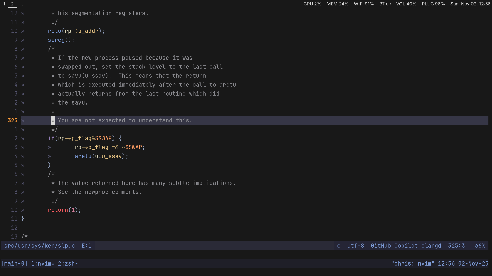

# Dotfiles

Designed to be simple, efficient, performant and stay out of the way. Keyboard and terminal-centric.
Unix keys in the terminal, Vim keys everywhere else.

## Core Stack

* **Window Manager:** `hyprland` on Arch and `sway` on Debian/Ubuntu, for simplicity and speed on Wayland.
  Server-like Waybar. Aerospace on macOS. i3-like keybindings.
* **Shell:** `zsh` with a minimal set of modern efficiency plugins.
  `fd`, `fzf`, `ripgrep` and `zoxide` integration for fast navigation. Unobtrusive Pure prompt.
* **Terminal:** `ghostty` for GPU-accelerated & Zig speed, Kitty graphics protocol and cross-platform momentum.
  JetBrains Mono.
* **Multiplexer:** `tmux` for session management. Minimal plugins for save/resume. `C-a` prefix. vi copy mode.
* **Editor:** `nvim` optimized for C, C++, Rust, Go, Python and JS/TS.\
  (lazy.nvim, mason, telescope, nvim-cmp, nvim-lspconfig, rustaceanvim, nvim-lint, conform, nvim-dap, neotest,
  vim-fugitive, gitsigns, claudecode, lazy-loaded utils)
* **Input:** `keyd` on Linux for system-wide modifier normalization,
  remaps standard and laptop keyboards to match split mechanical thumb cluster ergonomics. Capslock to Esc.
* **Extras:** Kanagawa Wave theme. `bat` for paging. `delta` for diffs. `gitui` for operational speed.



## Editor Toolchain

| Language | LSP | Lint / Diag | Format | Debug | Test |
| --- | --- | --- | --- | --- | --- |
| C/C++ | `clangd` | `clang-tidy` | `clang-format` | `lldb-dap` | `gtest` |
| CMake | `neocmake` | `neocmake` | `gersemi` | | |
| Rust | `rust-analyzer` | `clippy` | `rustfmt` | `codelldb` | `nextest` |
| Go | `gopls` | `golangci-lint` | `goimports` | `delve` | `go test` |
| Python | `pyrefly` | `ruff` | `ruff` | `debugpy` | `pytest` |
| Lua | `lua_ls` | `lua_ls` | `stylua` | | |
| Bash | `bashls` | `shellcheck` | `shfmt` | | |
| JS / JSX / TS / TSX | `tsc` | `biome` | `biome` | `js-debug-adapter` | `jest` / `vitest` |
| HTML | `html` | `html` | `html` | | |
| CSS | `cssls` | `biome` | `biome` | | |
| JSON | `jsonls` | `biome` | `biome` | | |
| Protobuf | `buf_ls` | `buf_ls` | `buf` | | |
| YAML | `yamlls` | `yamllint` | `yamlfmt` | | |
| TOML | `tombi` | `tombi` | `tombi` | | |
| Dockerfile | `docker_language_server` | `hadolint` | `dockerfmt` | | |
| Terraform / OpenTofu | `tofu_ls` | `tflint` | `tofu` | | |
| Markdown | `marksman` | `markdownlint-cli2` | `markdownlint-cli2` | | |

Most LSP servers are mason-managed. System-installed exceptions: C/C++, Rust, Protobuf, TOML.

Mason LSP servers which also provide diagnostics or formatting: CMake (diag), Lua (diag), HTML (diag, format).\
Remaining linters and formatters are system-installed.

Most debug servers are mason-managed or project-installed / on-demand. System-installed exception: C/C++.

Project-installed test frameworks / runners: C/C++, Python, JS / JSX / TS / TSX. System-installed: Rust, Go.

## Installation

To use these dotfiles, clone as a bare repo:

```sh
git clone --bare https://github.com/cosmoconsequent/.dotfiles.git $HOME/.dotfiles
```

Then run the following in tty / terminal emulator:

```sh
alias config='git --git-dir=$HOME/.dotfiles/ --work-tree=$HOME'
config config --local status.showUntrackedFiles no
```

Then checkout the files for Linux (Arch, Debian/Ubuntu):

```sh
config checkout linux
```

Or macOS:

```sh
config checkout macos
```
